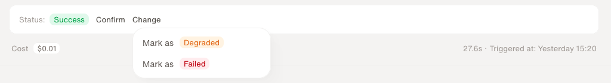

Once your agent runs on its own, its **Runs** list is where you see what happened. Every run gets a status, so you can tell at a glance which runs did their job and which need a look.

## Check how a run went

Every run in the agent's **Runs** list shows one of four statuses. Open a run to see its status spelled out next to **Status**.

| Status | In the **Runs** list | What it means | What to do |
| --- | --- | --- | --- |
| **Success** | Green check | The run did its job. A run that correctly found nothing to do — no new emails, no matching records — is a success too. | Nothing. |
| **Degraded** | Yellow warning | The main result arrived and is usable, but a smaller part fell short: an FYI wasn't sent, optional details are missing, or a few non-critical items were skipped. | Read the reason. If that part matters to you, tell the agent in chat. |
| **Failed** | Red cross | The main result is missing or wrong. For example, a connection or permission problem blocked the work, the run stopped early, the agent only said it couldn't do the job, something went to the wrong place or went out twice, or the agent reported results that didn't happen. | Open the run and read the reason, then fix the cause — reconnect an app, for example — or tell the agent in chat what it should have done. |
| **Completed** | Grey check | The run finished, but it has no status yet. | If you need to know now, look at the output yourself. |

A **Degraded** or **Failed** run comes with a one-line reason, such as *A connection, permission or quota problem blocked the work.* You see it in the **Runs** list and when you open the run.

## Correct a run's status

If a run got the wrong status — say it's marked **Failed** for something you meant it to do — you can change it. You need [**Can edit**](/share/share-an-agent) on the agent, and the run has to be finished.

<Steps>
<Step title="Open the run">

In the agent's **Runs** list, open the run.

</Step>
<Step title="Pick the right status">

Next to **Status**, click **Change**, then choose **Mark as Success**, **Mark as Degraded**, or **Mark as Failed**. The menu leaves out the status the run already has.

<Frame caption="The Change menu on a run marked Success.">
  
</Frame>

</Step>
<Step title="Say why">

Write what was intended and why, then click **Save**. A reason is required and can be up to 500 characters.

</Step>
</Steps>

The run now shows the status you picked, in the **Runs** list and everywhere else it appears. Your reason becomes its one-line reason, followed by *Corrected by* and your name.

Later runs of the same agent in the same situation get that status too. So describe the situation in your reason, not just this one run. A later run that got its status this way shows a one-line reason that explains why, even when it's a **Success**. Later runs don't pick up a new correction straight away — it can take up to a day.

To change your mind, click **Change** again. **Edit reason** lets you rewrite the reason, and **Remove correction** puts back the status the run had before.

If a run's status is right, you can click **Confirm** next to it. The run keeps its status and shows *Confirmed by* and your name. **Remove confirmation** in the **Change** menu undoes it.

You can also do this in the agent's chat: tell the agent which run got the wrong status and why, and it corrects the status for you.

<CardGroup cols={2}>
  <Card title="Versioning" icon="code-branch" href="/build/versioning">
    Next: iterate on your agent without fear of breaking it.
  </Card>
  <Card title="Your first agent" icon="sparkles" href="/build/your-first-agent">
    How to give your agent feedback in its chat.
  </Card>
</CardGroup>

{/* Sources:
   Run statuses: moved from build/your-first-agent (Nov 2026)
   Correct a run's status: tahoe PRs #1300 + #1328 (Nov 2026) */}
