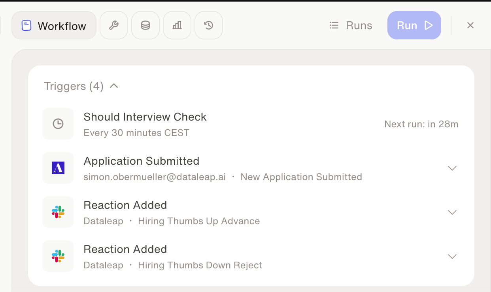

Triggers are how agents **wake up**. Instead of you starting each run, the agent starts itself when its trigger fires. Choosing the right trigger type is the single biggest lever you have on both cost and reliability.

## The three trigger types

| Type | The agent runs… | Best for | Watch out |
|---|---|---|---|
| **Manual** | when you start it | experiments, one-off jobs, sensitive workflows where a human decides every run | doesn't scale beyond you |
| **Scheduled** | on a fixed cadence (hourly, daily, weekly) | digests, briefings, genuinely time-based reports | usually not the best option — runs whether or not there's work |
| **Event-based** | only when something happens (Slack message, webhook, integration event) | reactive workflows — "when X happens, do Y" | design for missed events in very bursty scenarios |

The rule of thumb: **event-based triggers are often the best choice** — the agent runs only when there is actual work, and it reacts instantly. Scheduled triggers can work, and manual triggers have their place for workflows a human should start deliberately. But the rule that holds for every type: **make the trigger as precise as possible**.

<Info>
  **A real example:** a meeting-briefing agent first ran on a daily 8 AM schedule. Weekend runs found nothing, and meetings booked during the day were missed entirely. Rebuilt with an event trigger — wake up 15 minutes before each meeting — it runs only when there actually is a meeting, always with fresh information.
</Info>

<Note>
  **Cost example:** checking for new items on a tight schedule costs around $50 per month, because most runs find nothing. The same workflow with an event trigger costs around $0.50 per month. That is roughly 100x cheaper.
</Note>

## Make every trigger as specific as possible

Use trigger conditions so the agent does not run on irrelevant events — every filtered-out event is a run you don't pay for and an error that can't happen.

| | Trigger | What happens |
|---|---|---|
| 🔴 Costly | On **any new email** | Fires on everything and burns runs on noise. |
| 🟢 Lean | Filtered by **sender, subject & keywords** | Only the few relevant emails ever wake the agent. |

Specific triggers = fewer runs, lower cost.

## Skip quiet runs with a quick check

Some triggers can't be made precise enough. A schedule that looks for new orders still wakes the agent every time, even when there are none. In cases like this, the agent can add a quick check that runs first, before the AI does anything.

- **The check finds nothing to do.** The run ends right there and shows as **Success**, with the check's short message as its result. No AI step runs, so a quiet run costs almost nothing.
- **The check finds work, fails, or can't decide.** The agent takes over as usual. It sees what the check did and found, so it can pick up from there.

The check runs whenever a trigger starts a run, and when you start a run by hand. It never runs when someone chats with the agent or when another agent calls it.

You don't set this up yourself. When you create or change a trigger where most runs would find nothing, or where a fixed rule decides what happens, the agent can offer the check in plain words. It adds the check only if you agree. You can also ask for it in the agent's chat, for example: "Most runs find nothing. Add a quick check that skips the run when there's nothing new." The agent's instructions then get one line that starts with `Entry command:` and says what the check decides. To remove the check, ask the agent.

<Note>
  A quick check fits when a simple rule decides: there are no new orders, the email isn't from a customer, or the ticket was already handled. It doesn't fit when each run needs judgment, such as reading, weighing, or writing. Most agents don't need one.
</Note>

## Manual triggers you already have

The best trigger is often a quick action you already do in your daily tools — no new infrastructure needed:

| Pattern | How it works |
|---|---|
| **Notion automations** | A property change (e.g., status set to "Done") fires a Dataleap workflow: Notion → Create automation → trigger on property edit. |
| **Labels as triggers** | In Gmail, HubSpot, Jira, and even ATS tools, applying a label to an item starts the agent — a powerful pattern most users don't think of. |
| **Any quick action** | Labels, status changes, checkboxes, tags: if it's a one-click action in an interface you already use, it can trigger an agent. |

## Approvals as triggers

Human-in-the-loop checkpoints can be built with triggers: the agent sets a field, status, or label and stops; a human changing that value is the event that triggers the next step. This gives you an approval gate without extra infrastructure — see [Shape agent behavior](/build/shape-agent-behavior) for the HITL pattern.

Here's a real agent using several trigger types at once — including two Slack-reaction triggers as approval gates (👍 advances the candidate, 👎 rejects):

<Frame caption="One hiring agent, four triggers: a schedule, an application event, and two reaction-based approvals.">
  
</Frame>

## Two things that bite

<Warning>
  **A copied agent carries the original's triggers** (disabled by default). Reconfigure them before enabling — otherwise the copy fires alongside the original.
</Warning>

<Warning>
  For very bursty event sources (many simultaneous webhook events), don't assume every event is queued and processed — runs can be dropped in burst scenarios. If your workflow can't tolerate a missed event, add a periodic catch-up run.
</Warning>

<Card title="Watch: Triggers — or how to wake up your agent" icon="clapperboard" href="/video-series/section-2#triggers-or-how-to-wake-up-your-agent" horizontal>
  See how triggers are set up in the product.
</Card>

<CardGroup cols={2}>
  <Card title="Versioning" icon="code-branch" href="/build/versioning">
    Next: iterate on your agent without fear of breaking it.
  </Card>
  <Card title="Credits & usage" icon="chart-line" href="/admin/credits-and-usage">
    How trigger choice fits into overall spend control.
  </Card>
</CardGroup>

{/* Sources:
   https://www.notion.so/38222bd1f6b681a4a1e3dc06bc55ac39?pvs=1
   https://www.notion.so/39522bd1f6b681798a21de16d9bf3781
   https://www.notion.so/39522bd1f6b681efa08ee49e6001f19c
   https://www.notion.so/39422bd1f6b681b9a65bfa12f600e948
   https://www.notion.so/38822bd1f6b6807ca713cb0abd44f449?pvs=1
   https://www.notion.so/a0822bd1f6b68301a250818d30e8ab93 */}
