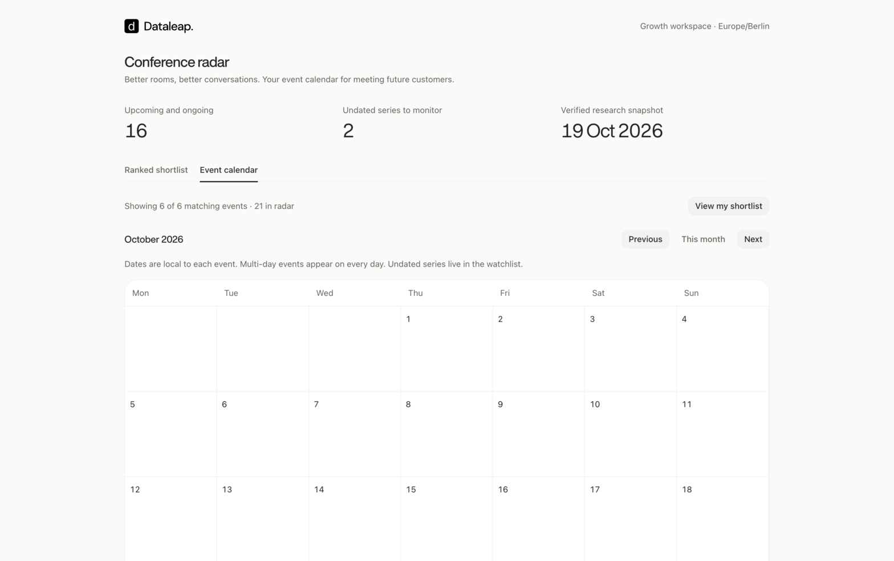
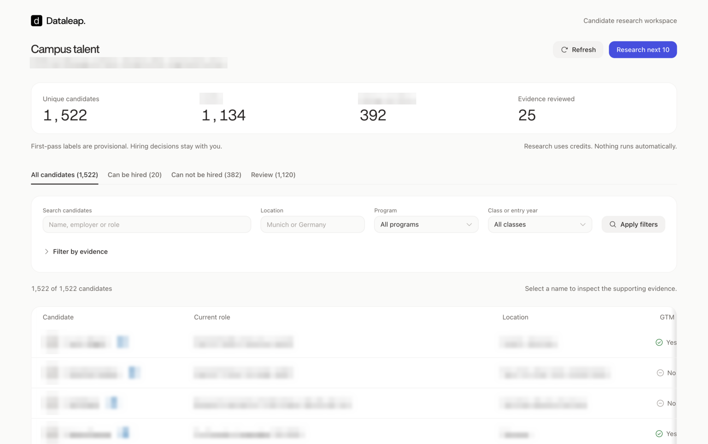
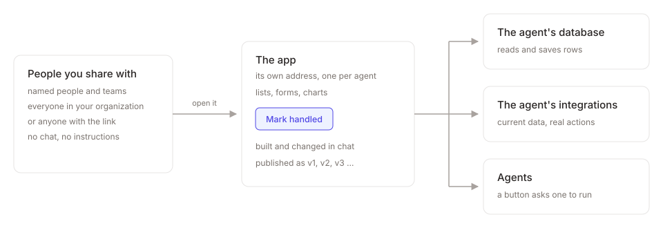
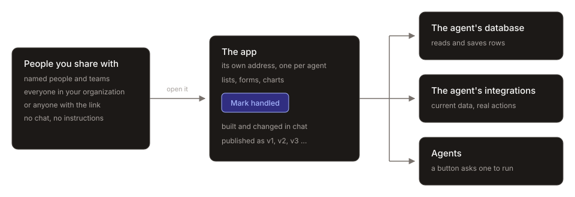
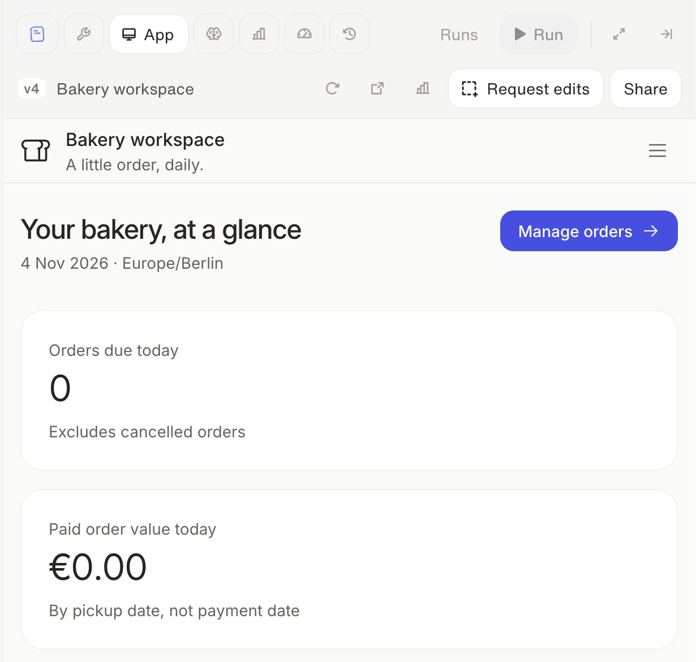
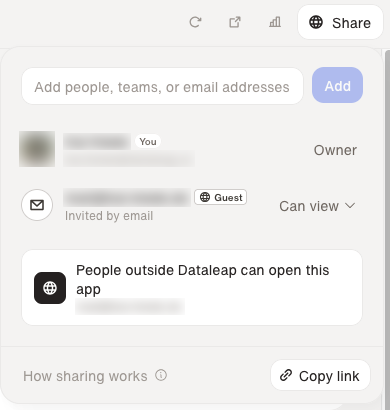

Ask your agent for an app and it builds you a small web app: a tracker, a review queue, a request form, or a dashboard that always shows current figures. You build it in chat. The people you share it with open it in their browser.

<Frame caption="An app that tracks events worth attending, open on its calendar view">
  
</Frame>

<Frame caption="A candidate research app with tabs, filters, and buttons that ask its agent for more work. Personal details are blurred.">
  
</Frame>

## What an app can do

- **Show current data.** It reads from the agent's [database](/build/agent-database) and [integrations](/build/connect-your-tools) whenever someone opens it.
- **Save what people enter.** Forms and edits are stored in the agent's database.
- **Take action in your tools.** A button can update a record or send something through the agent's integrations.
- **Ask an agent to do work.** A button can start a run of this agent or another one. See [Add a button that runs an agent](#add-a-button-that-runs-an-agent).
- **Be shared without the agent.** People use the app without seeing the agent's chat, instructions, or integrations.
- **Keep one address.** New versions replace the old one at the same address, so the link you sent keeps working.

<Frame caption="An app sits between the people who use it and the agent behind it.">
  
  
</Frame>

## App or dashboard?

Both give you a page you can send to someone. The difference is whether the page keeps working with your data after your agent has built it.

|  | [Dashboard](/scale/dashboards) | App |
|---|---|---|
| Data | A snapshot from the moment your agent built the page | Current: read from the agent's database and integrations whenever someone opens it |
| What people type in | Gone when they reload | Saved in the agent's database |
| Buttons that run an agent | Work only for people who manage the agent | Work for everyone you share the app with |

Pick a dashboard for a page that is finished once it's built, such as last month's report. Pick an app for a place people come back to, where the data changes or where they take action.

## Before you start

- **Your agent can only show what it can reach.** For live data from a tool, [connect the integration](/build/connect-your-tools) first. Anything people enter in the app is saved in the agent's database, so there is nothing to set up for that.
- **One app per agent.** Your agent builds new requests into the app it already has. It replaces the app only when you confirm, and the old address stops working straight away.

## Ask for one

Describe what people should do with the app and who it is for.

- "Build an app where the support team sees open tickets by priority and can mark one as handled."
- "Build a laptop request form that saves each request and gives me a list I can approve from."
- "Turn the weekly pipeline numbers you save into an app the sales team can open any time."

You can also click **Workflow** in the top right of the agent, open the **App** tab, and click **Ask the agent to build one**. Your agent may suggest an app on its own when your workflow would benefit from one.

Your agent asks questions only when the answer changes what it builds. Details such as names, labels, or thresholds become clearly marked placeholders, and your agent lists them when it reports back, so you can send the real values afterwards.

When the app is ready, your agent posts a card in the chat showing the app's name and its version, such as **App · v1**. Click **Open preview** to open it in the agent's sidebar, or open it in a new tab. The app's address also shows below the chat box, next to **App:**.

## Change it and publish new versions

Ask for changes in the same chat. Your agent edits the app, checks it, and publishes a new version: **v2**, **v3**, and so on.

<Warning>
  **Everyone sees changes while they are being made.** As soon as your agent starts editing, everyone who opens the app sees the work in progress, not just you. When the agent publishes, everyone moves to the new version. If a draft gets no changes for 30 minutes, the app goes back to its last published version.
</Warning>

To see the app on the agent, click **Workflow** in the top right and open the **App** tab. It shows the app with a toolbar above it:

<Frame caption="An app open in the App tab. The toolbar above it shows the published version, the app's name, Reload, Open in new tab, Analytics, Request edits, and Share.">
  
</Frame>

| You see | What it means |
|---|---|
| **v3** | The published version people get |
| **Draft · unpublished changes** | Your agent has changed the app since the last version. Everyone sees the draft. |
| **Draft · starting…** | The draft is starting up |
| **Draft · has an error** | The draft didn't start. Tell your agent in the chat, and it fixes the error. |
| **Reload** | Loads the app again |
| **Open in new tab** | Opens the app at its own address |
| **Analytics** | Shows who uses the app. See [See who uses it](#see-who-uses-it). |
| **Request edits** | Lets you click a part of the app and tell your agent what to change. See [Point at what to change](#point-at-what-to-change). |
| **Share** | Chooses who can open the app. See [Share your app](#share-your-app). A globe on the button means people outside your organization can open it. |

To go back to an earlier version, ask your agent, for example: "Restore the app to v2." It publishes the old version again as a new one. Restoring changes only the app. The agent's database keeps its current data.

### Point at what to change

Instead of describing where something is in the app, click it. Your agent gets the exact part you clicked together with your note, so you don't need to paste a screenshot or explain where to look.

<Steps>
  <Step title="Turn on Request edits">
    In the **App** tab, click **Request edits** in the toolbar. Inside the app, the part under your pointer is outlined, and a bar at the bottom reads **Click anything to request an edit**. While it's on, a click picks that part of the app instead of pressing a button or following a link.
  </Step>
  <Step title="Click the part you want changed">
    Click it, type what should change into **What should change?**, and click **Add**. Your request appears above the chat box. Repeat for anything else you want changed.
  </Step>
  <Step title="Send your requests">
    Click **Send** in the bar in the app, or send your next chat message. Your requests go into the agent's chat, and your agent makes the changes.
  </Step>
</Steps>

- **Up to five requests per message.** After five, send the message to add more.
- **Remove a request before you send it** by clicking × on it above the chat box.
- **Use the app normally again** by clicking **Request edits** again or pressing Esc. Requests you've added stay above the chat box.

You see **Request edits** only if you can edit the agent, and only when you use a mouse or trackpad. It stays greyed out until the app has loaded.

## Add a button that runs an agent

An app can carry a button that asks an agent to do some work: rebuild a report, look into the row someone picked, or file what they typed as a ticket. Ask for it in those words, and name the agent:

- "Add a Refresh button that asks you to update the figures."
- "Add a Look into this button to each row that asks my Account Research agent to dig into that account."

Your agent adds a button like this only when you ask for one. Asking for an app, a form, or filters never gets you one on its own.

- **Everyone who can open the app can press it.** That's the difference from a [dashboard button](/scale/dashboards#ask-for-a-button-that-runs-an-agent), which works only for people who manage the agent.
- **It runs only when someone presses it.** An app never starts an agent on its own, for example when the page loads.
- **The app shows how it went.** Your agent builds the button to show that the work is running. A quick answer can come straight back to the page, and the app says plainly if the agent needs more information or the run didn't finish.
- **The agent you name pays for its run** and works the way it always does, with its own instructions and integrations. The app can call this agent, or any agent this agent [can reach](/scale/agent-to-agent-communication#who-an-agent-can-reach).

## Show each person their own view

An app knows who is viewing it: their email address, and their role on the agent. So the same app can show different people different things. Ask for it in those words:

- "Show each person only the requests they submitted."
- "Only people who can manage the agent should see the Approve button."

Your agent builds views like this only when you ask. It never adds a login page or passwords to the app, because Dataleap checks who people are before they reach it.

<Note>
  The app's code decides who sees what, so check the result before you rely on it. For example, ask a colleague to open the app and confirm they see only their own rows.
</Note>

## Share your app

At first, only people who have access to the agent can open its app. To let anyone else open it, add them in the app's **Share** dialog. You need **Can manage** on the agent to change this. With **Can edit**, you see who can open the app but can't change it.

<Steps>
  <Step title="Open Share">
    On the agent, click **Workflow** in the top right, open the **App** tab, and click **Share** in its toolbar.
  </Step>
  <Step title="Add people">
    Type into **Add people, teams, or email addresses**, pick a suggestion, and click **Add**. **Can view** is the only role. It lets them open and use the app.

    | You add | Who can open the app |
    |---|---|
    | A person or a team in your organization | That person, or every member of that team. They log in to Dataleap. |
    | **Everyone in** followed by your organization's name | Every member of your organization. If your organization has verified email domains, anyone with an address at those domains can open it too. |
    | An email address outside your organization | That person, as a guest. They get an email invitation. |
    | A whole domain, such as `@customer.com` | Anyone with an address at that domain, as a guest. No email is sent, so send them the link yourself. |
  </Step>
  <Step title="Send the link">
    Click **Copy link** and send it. The link opens the app only for people you added.
  </Step>
</Steps>

<Warning>
  **People who open the app act with the agent's integrations.** That includes guests from outside your organization. They can use every list, form, and button the app has, including buttons that change data in your tools or ask an agent to run. Before you share it, make sure everyone you add should see what it shows and do what it does. **How sharing works** in the share dialog sums this up.
</Warning>

### Share with people outside your organization

People outside your organization open the app as guests. Guests don't need a Dataleap account.

<Frame caption="The share dialog with one guest added by email. Names, email addresses, and the profile picture are blurred.">
  
</Frame>

- **Guests confirm their email address with a code.** When a guest opens the app, they click **Continue with email**, enter the address you shared the app with, and type the 6-digit code they get by email. A code works for 10 minutes.
- **Guests stay signed in.** A guest usually confirms their address once per browser. Guests who get in through a domain confirm it again every 90 days.
- **You see who is outside.** Guests carry a **Guest** badge in the share dialog, and a line under the list tells you whether people outside your organization can open the app. While they can, the app's **Share** button shows a globe.
- **Some domains can't be added.** You can't add a whole free email domain, such as `@gmail.com`, or a disposable email domain. Add people by their own address instead.
- **Colleagues stay colleagues.** If you type the address of someone in your organization, they're added as themselves and open the app by logging in to Dataleap.

Removing someone, including a guest, can take up to a minute.

Sharing an app doesn't share the agent. People who open the app can't see its chat, instructions, or integrations. It doesn't work the other way round: everyone who has access to the agent, including [**Can use**](/share/share-an-agent), can also open its app. To let someone use only the app, add them in the app's **Share** dialog and not on the agent.

## See who uses it

Click **Analytics** in the app's toolbar. Choose **Last 7 days**, **Last 30 days**, or **Last 90 days** to see:

- **Page views** and **Unique visitors**, day by day
- **Audience**: how many visitors are from **Your organization** and how many are **Guests**. Visits from before guests replaced public links show as **Anonymous**.
- **Most viewed pages**

Opening the app in the agent's sidebar doesn't count as a page view.

## Costs and limits

- **The agent's owner pays.** When the app uses an integration that costs credits, the agent's owner pays, not the person using the app. A team agent's app is paid from the team. In usage, these costs count as chat costs. When a button asks an agent to run, that agent pays for its run, the same as any other run. See [Credits and usage](/admin/credits-and-usage#chat-costs-vs-run-costs).
- **Copies and templates don't include the app.** A copy of the agent, or an agent deployed from a [template](/share/templates), starts without one.
- **Disabling the agent keeps the app working.** Archiving the agent stops the app.
- **Admins see what the app does.** The integration calls an app makes show in [Integration Activity](/admin/connected-apps-management#integration-activity).

## If someone can't open the app

| They see | What to do |
|---|---|
| **This app doesn't exist or you don't have access** | Check the link, or add them in the app's **Share** dialog. A guest who confirmed a different address can click **Use a different email**. |
| **This app is unavailable** | The app may be starting up or having a problem. Wait a moment and try again. If it keeps happening, tell your agent in the chat. |
| **Starting this app…** | The page reloads by itself, usually within a minute. |
| **Your access to this app has expired** or **You're signed out of this app** | Open the app again from Dataleap. A guest opens the app's link again. |
| A guest gets no code | Dataleap sends a code only to an address that has access. Check that you added their exact address, or their domain. |
| **That code didn't work**, **This code has expired**, or **Too many attempts** | Check the code, or click **Request a new code** and use the newest one. |

## Related

<CardGroup cols={2}>
  <Card title="Build a dashboard" icon="chart-line" href="/scale/dashboards">
    For a finished page, such as a report, that doesn't need to stay current.
  </Card>
  <Card title="Database" icon="database" href="/build/agent-database">
    Where your agent keeps the data your app reads and saves.
  </Card>
  <Card title="When to share what" icon="share-nodes" href="/share/when-to-share-what">
    Pick between sharing an app, a dashboard, a template, and the agent itself.
  </Card>
  <Card title="Share an agent" icon="user-plus" href="/share/share-an-agent">
    When people should chat with the agent rather than use an app.
  </Card>
</CardGroup>

{/* Sources:
   Product: dataleap-labs/tahoe PR #917 and follow-ups; ADRs 0072, 0073, 0074, 0075, 0086; read at tahoe main 488c5f74 (2026-10-19).
   UI strings: interface-section.tsx, share-interface-popover.tsx, interface-analytics-view.tsx, interface-preview-card.tsx, interface-gateway/src/pages.ts.
   Requested in #docs-ideas by Wina Tungmiharja, 2026-10-20.
   Guests and per-viewer views: tahoe PR #1011 (ADR 0096) and ADR 0102; share-interface-popover.tsx, interface-guests.ts, -guest-sign-in.tsx, guest_emails.go, grants.go, agent_access.go, apps SKILL.md; read at tahoe main 04b4aadd (2026-10-30).
   Screenshot images/apps-share-dialog.svg: PNG supplied by Kai Klede in #docs-ideas 2026-11-02, cropped to the dialog, names/emails/avatar blurred, wrapped in SVG.
   Request edits: tahoe PR #1049 (ADR 0101); request-edits-button.tsx, interface-section.tsx, composer-requests.tsx, sandbox runtime comments.js; read at tahoe main 73696df2 (2026-11-04). */}
